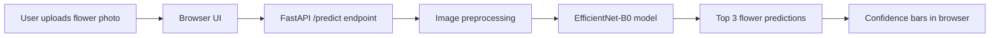

# 🌼 FloraLens — Flower Detective Extraordinaire

<div align="center">
  
</div>

<p align="center">
  
  
  
  
</p>

> “A flower is just a plant with excellent branding.” — some very wise botanist, probably

## ⭐ Why this project is ridiculously cool

FloraLens is a flower recognition app that lets you upload a photo and instantly get the top predicted flower species. It combines a trained deep learning model with a simple browser UI and a lightning-fast API backend.

It is the kind of project that makes you feel like a wizard:

- Upload a flower pic
- API analyzes it
- Model makes a guess
- UI shows the top 3 candidates with confidence bars

It is basically a tiny AI botanist. No lab coat required.

---

## ✨ Features

- 🌸 Image upload from browser or drag-and-drop
- 🧠 Deep learning classification using EfficientNet-B0
- 📊 Top-3 predictions with confidence scores
- ⚡ FastAPI backend for quick responses
- 🌐 Simple web interface served directly from the app
- 🏷️ Trained on Oxford Flowers 102 dataset categories

---

## 🖼️ Screenshots

<div align="center">
  
  
  
</div>

<div align="center">
  
</div>

---

## 🚀 How it works



The app:

1. Accepts an image file from the browser
2. Converts and normalizes the image for model input
3. Runs inference with a pretrained EfficientNet model
4. Returns the best matching species and confidence values
5. Displays the result with a clean visual interface

---

## 🧪 Tech stack

- Python
- FastAPI
- PyTorch
- TorchVision
- timm
- Pillow
- HTML + CSS + JavaScript

---

## 📦 Project structure

```text
flora-lens/
├── main.py                # FastAPI backend and prediction logic
├── index.html             # Browser UI
├── requirements.txt       # Python dependencies
├── models/
│   ├── best_model.pt      # trained model weights
│   ├── classes.json       # flower class names
│   └── history.json       # training history / metadata
├── README.md              # project documentation
└── .gitignore             # optional local project ignore rules
```

---

## ⚙️ Installation

1. Clone the project

```bash
git clone https://github.com/your-username/flora-lens.git
cd flora-lens
```

2. Create a virtual environment

```bash
python -m venv .venv
```

3. Activate it

```bash
# Windows
.venv\Scripts\activate

# Linux / macOS
source .venv/bin/activate
```

4. Install dependencies

```bash
pip install -r requirements.txt
```

---

## ▶️ Run the app

Start the backend server:

```bash
uvicorn main:app --reload --host 0.0.0.0 --port 8000
```

Then open:

```text
http://127.0.0.1:8000/
```

The browser UI will load and let you upload a flower photo.

---

## 🧠 API endpoint

### POST /predict

Upload an image and receive top predictions.

#### Example

```bash
curl -X POST "http://127.0.0.1:8000/predict" \
  -F "file=@flower.jpg"
```

#### Response

```json
{
  "predictions": [
    {"species": "daisy", "confidence": 0.9234},
    {"species": "sunflower", "confidence": 0.0521},
    {"species": "rose", "confidence": 0.0188}
  ]
}
```

---

## 🌼 Model notes

This project uses a model trained to recognize flower classes from the Oxford Flowers 102 dataset. In practical terms:

- it works best on flowers that look like the training set
- it may be confused by weird lighting, blurry shots, or non-flower objects
- near 100% confidence is rare in the real world, and that is totally normal

So yes, the AI is smart — but not magically smarter than a botanist with a camera.

---

## 🏆 Fun use cases

- Identify flowers during a walk in the park
- Explore botanical species from photos
- Build a tiny AI flower assistant for learning
- Turn this into a garden companion app later

---

## 🔮 Future upgrades

- Add species descriptions and care tips
- Support multiple languages
- Improve model accuracy with data augmentation
- Add a history of predictions
- Build a mobile app version
- Add a real “guess confidence + explanation” panel

---

## ✅ Current status

This project is a working local demo with:

- a trained model
- browser upload interface
- prediction API
- flower classification flow

It is ready for experimentation, learning, and extension.

---

## 💬 Final thought

If flowers had a social media profile, FloraLens would be the app that helps them say:

> “Hi, I’m a rose, but I am not actually a rose.”

You upload the bloom, the model tries its best, and the magic of computer vision does the rest.

---

<p align="center">
  
</p>

<p align="center">
  <strong>⭐ Made with curiosity, flowers, and a little bit of AI chaos ⭐</strong>
</p>
